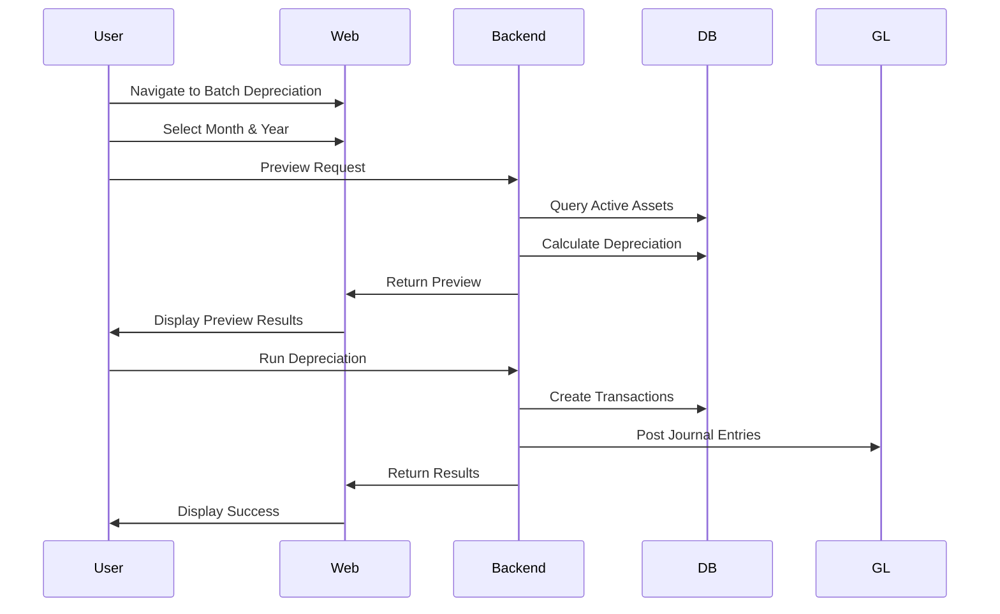
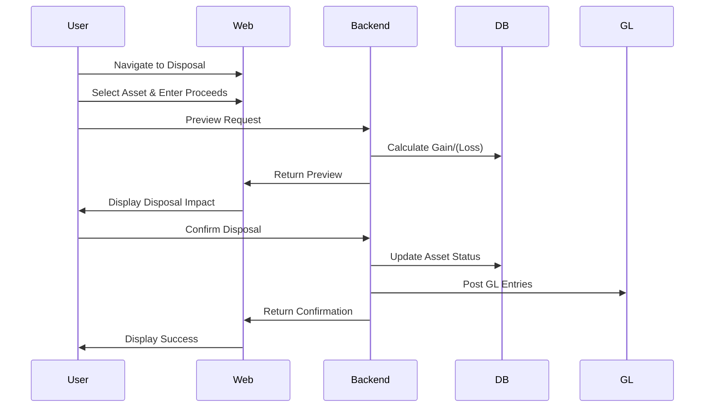

# Fixed Assets Phase 4 - Implementation Documentation

> **Module**: Finance - Fixed Assets Phase 4
> **Sprint**: Phase 4
> **Version**: 1.0.0
> **Status**: Complete
> **Last Updated**: January 2025

## Table of Contents

1. [Overview](#overview)
2. [Features](#features)
3. [System Architecture](#system-architecture)
4. [API Endpoints](#api-endpoints)
5. [Backend Implementation](#backend-implementation)
6. [Frontend Components](#frontend-components)
7. [User Flows](#user-flows)
8. [Permissions](#permissions)
9. [Integration Points](#integration-points)
10. [Testing Strategy](#testing-strategy)
11. [Technical Decisions](#technical-decisions)
12. [Notes & Improvements](#notes--improvements)

## Overview

Fixed Assets Phase 4 introduces batch depreciation, asset disposal, and asset revaluation workflows to the GIMS Finance module. This phase focuses on **automation**, **batch operations**, and **compliance** with international accounting standards.

### Key Capabilities

| Feature | Description | Status |
|---------|-------------|--------|
| **Batch Depreciation** | Automated monthly depreciation calculation for all assets with preview functionality | Complete |
| **Asset Disposal** | End-of-life asset disposal with automatic p&l recognition | Complete |
| **Asset Revaluation** | Periodic asset revaluation with approval workflow | Complete |
| **Journal Entry Integration** | Automatic GL posting for all depreciation, disposal, and revaluation transactions | Complete |
| **Audit Trail** | Complete history of all asset transactions | Complete |

## Features

### 1. Batch Depreciation

**Purpose**: Automate monthly depreciation calculation for all active assets

**Workflow**:
1. User selects month and year
2. System preview shows all assets and calculated depreciation
3. User confirms and runs batch process
4. System creates GL journal entries and updates asset book values
5. Results are displayed with summary statistics

**Business Rules**:
- Only active assets are included in depreciation
- Assets already fully depreciated are skipped
- Depreciation methods supported: Straight-line, Double declining balance, Sum-of-years-digits, Units of production
- No manual depreciation allowed for assets with automated depreciation enabled

**Key Implementation Details**:
```
GET  /api/v1/accounting/asset-depreciation/preview?month=1&year=2024
  → Returns preview of depreciation for the period

POST /api/v1/accounting/asset-depreciation/run
  Body: { month: 1, year: 2024 }
  → Executes batch depreciation, creates journal entries
```

### 2. Asset Disposal

**Purpose**: Record asset disposal and automatically recognize gain/loss on p&l

**Workflow**:
1. User selects asset to dispose
2. Enters disposal details (date, proceeds amount, bank account)
3. System calculates gain/(loss) = proceeds - book value
4. System creates GL entries:
   - Debit: Bank Account (proceeds)
   - Credit: Fixed Asset (net book value)
   - Debit/Credit: Disposal Account (gain/loss)
5. Asset marked as disposed with historical data retained

**Business Rules**:
- Cannot dispose fully depreciated assets without explicit confirmation
- Proceeds amount is optional (can be $0 for scrap disposal)
- Only active users with "asset.update" permission can dispose assets
- Disposal date cannot be before asset acquisition date

**Key Implementation Details**:
```
GET  /api/v1/accounting/asset-disposal/{assetId}/preview
  → Preview disposal transaction and GL entries

POST /api/v1/accounting/asset-disposal/{assetId}/confirm
  Body: { proceedsAmount, disposalDate, bankAccountId }
  → Confirms disposal and posts GL entries
```

### 3. Asset Revaluation

**Purpose**: Support periodic fair value revaluation of assets

**Workflow**:
1. User submits revaluation request for an asset
2. Enters new revaluation amount and effective date
3. System calculates revaluation delta and impact on OCI/Reserves
4. Submission goes to approval queue (configurable by role)
5. Approver reviews and approves/rejects
6. Upon approval:
   - Asset book value updated
   - GL entries posted to OCI or Reserves account
   - Historical revaluations tracked
7. Rejection returns to draft state for revision

**Business Rules**:
- Revaluation delta can be positive or negative
- Only assets purchased >1 year ago can be revalued
- Approvers are configured per company
- Cannot revalue assets marked for disposal
- Revaluation effective date cannot be in the future

**Key Implementation Details**:
```
GET  /api/v1/accounting/asset-revaluation/{assetId}/preview
  → Preview revaluation delta and GL impact

POST /api/v1/accounting/asset-revaluation
  Body: { assetId, revaluationAmount, effectiveDate, description }
  → Create revaluation request (draft status)

POST /api/v1/accounting/asset-revaluation/{transactionId}/approve
  → Approve revaluation request
```

## System Architecture

### Backend Structure

```
internal/finance/asset-depreciation/     # Batch depreciation
  ├── data/models/
  │   └── depreciation_model.go          # DepreciationTransaction, DepreciationLine
  ├── data/repositories/
  │   └── depreciation_repository.go     # CRUD operations
  ├── domain/dto/
  │   └── depreciation_dto.go            # Request/Response DTOs
  ├── domain/usecase/
  │   └── depreciation_usecase.go        # Business logic
  ├── presentation/handler/
  │   └── depreciation_handler.go        # HTTP handlers
  └── presentation/router/
      └── depreciation_router.go         # Routes

internal/finance/asset-disposal/         # Asset disposal
  ├── data/models/
  │   └── disposal_model.go              # DisposalTransaction
  ├── domain/usecase/
  │   └── disposal_usecase.go            # Disposal logic
  └── presentation/handler/
      └── disposal_handler.go            # HTTP handlers

internal/finance/asset-revaluation/      # Asset revaluation
  ├── data/models/
  │   └── revaluation_model.go           # RevaluationTransaction
  ├── domain/usecase/
  │   └── revaluation_usecase.go         # Revaluation logic
  └── presentation/handler/
      └── revaluation_handler.go         # HTTP handlers
```

### Frontend Structure

```
features/finance/fixed-assets/
├── types/
│   └── index.d.ts                       # Type definitions
├── schemas/
│   └── fixed-assets.schema.ts           # Zod validation schemas
├── stores/
│   └── useFixedAssetsStore.ts           # Zustand state (if needed)
├── hooks/
│   ├── use-batch-depreciation.ts        # Batch depreciation queries/mutations
│   ├── use-asset-disposal.ts            # Disposal queries/mutations
│   └── use-asset-revaluation.ts         # Revaluation queries/mutations
├── services/
│   └── fixed-assets-service.ts          # API calls
├── components/
│   ├── batch-depreciation-preview.tsx   # Preview component
│   ├── batch-depreciation-results.tsx   # Results component
│   ├── asset-disposal-form.tsx          # Disposal form
│   ├── asset-disposal-list.tsx          # Disposal list
│   ├── asset-revaluation-form.tsx       # Revaluation form
│   └── asset-revaluation-list.tsx       # Revaluation list
└── i18n/
    ├── en.ts                            # English translations
    └── id.ts                            # Indonesian translations
```

## API Endpoints

### Batch Depreciation

| Method | Endpoint | Permission | Description |
|--------|----------|------------|-------------|
| GET | `/api/v1/accounting/asset-depreciation/preview` | asset.read | Preview depreciation for period |
| POST | `/api/v1/accounting/asset-depreciation/run` | asset.depreciate | Execute batch depreciation |
| GET | `/api/v1/accounting/asset-depreciation/history` | asset.read | Get depreciation history |

**Request/Response Examples**:

**Preview Request**:
```json
GET /api/v1/accounting/asset-depreciation/preview?month=1&year=2024
```

**Preview Response**:
```json
{
  "success": true,
  "data": {
    "total_assets": 125,
    "total_lines": 347,
    "successful": 342,
    "failed": 5,
    "skipped": 0,
    "total_depreciation_amount": 1500000.00,
    "preview_lines": [
      {
        "asset_id": "asset-001",
        "asset_code": "FA-001",
        "asset_name": "Building",
        "method": "straight_line",
        "status": "new",
        "depreciation_amount": 50000.00,
        "book_value": 950000.00
      }
    ]
  }
}
```

**Run Response**:
```json
{
  "success": true,
  "data": {
    "total_assets": 125,
    "successful": 342,
    "failed": 5,
    "total_amount": 1500000.00,
    "journal_ids": ["JE-2024-001", "JE-2024-002"]
  }
}
```

### Asset Disposal

| Method | Endpoint | Permission | Description |
|--------|----------|------------|-------------|
| GET | `/api/v1/accounting/asset-disposal/{id}/preview` | asset.read | Preview disposal impact |
| POST | `/api/v1/accounting/asset-disposal/{id}/confirm` | asset.update | Confirm disposal |
| GET | `/api/v1/accounting/asset-disposal/list` | asset.read | List all disposals |

### Asset Revaluation

| Method | Endpoint | Permission | Description |
|--------|----------|------------|-------------|
| GET | `/api/v1/accounting/asset-revaluation/{id}/preview` | asset.read | Preview revaluation |
| POST | `/api/v1/accounting/asset-revaluation` | asset.revalue | Create revaluation request |
| POST | `/api/v1/accounting/asset-revaluation/{id}/approve` | asset.approve | Approve revaluation |
| GET | `/api/v1/accounting/asset-revaluation/list` | asset.read | List revaluations |

## Backend Implementation

### Key Classes & Models

**DepreciationTransaction**:
- Contains overall transaction metadata
- Links to multiple DepreciationLine records
- Statuses: pending, completed, failed

**DepreciationLine**:
- One record per asset per month
- Stores calculated depreciation amount
- Tracks GL posting status

**DisposalTransaction**:
- Records asset disposal
- Calculates gain/(loss)
- Links to GL journal entries

**RevaluationTransaction**:
- Workflow-enabled (Draft → Approved → Posted)
- Links to GL posting
- Tracks approval history

### Business Logic Highlights

**Depreciation Calculation**:
```go
// Straight-line method
monthlyDepreciation = (AcquisitionCost - SalvageValue) / UsefulLifeMonths

// Double declining balance
monthlyDepreciation = BookValue * (1 - (1 / UsefulLifeMonths)) * 2

// Sum-of-years-digits
remainingYears = (UsefulLifeMonths - ElapsedMonths) / 12
monthlyDepreciation = (Cost - SalvageValue) * (remainingYears / SumOfYears)
```

**Disposal Gain/(Loss) Recognition**:
```go
gain := proceedsAmount - netBookValue
if gain > 0 {
    // Debit Cash, Credit Disposal Gain
} else {
    // Debit Disposal Loss, Credit Cash
}
```

**Revaluation Impact**:
```go
revaluationDelta := newRevaluationAmount - previousBookValue
if revaluationDelta > 0 {
    // Increases OCI/Revaluation Reserve
} else {
    // May reverse previous revaluation gains or recognize loss
}
```

## Frontend Components

| Component | File | Purpose |
|-----------|------|---------|
| BatchDepreciationPreview | batch-depreciation-preview.tsx | Period selection & preview results |
| BatchDepreciationResults | batch-depreciation-results.tsx | Display batch execution results |
| AssetDisposalForm | asset-disposal-form.tsx | Form for entering disposal details |
| AssetDisposalList | asset-disposal-list.tsx | Table of completed disposals |
| AssetRevaluationForm | asset-revaluation-form.tsx | Form for revaluation submission |
| AssetRevaluationList | asset-revaluation-list.tsx | List of revaluation requests |

### Component Responsibilities

- **Forms**: Validation, submission, error handling
- **Lists**: Pagination, sorting, filtering
- **Results**: Summary statistics, transaction details, error reporting

## User Flows

### Batch Depreciation Flow



### Asset Disposal Flow



## Permissions

| Permission | Role | Description |
|------------|------|-------------|
| asset.read | Finance Manager, Accountant, Viewer | Read fixed asset data |
| asset.depreciate | Finance Manager | Run batch depreciation |
| asset.update | Finance Manager | Dispose assets |
| asset.revalue | Finance Manager | Submit asset revaluations |
| asset.approve | Controller, CFO | Approve asset revaluations |

## Integration Points

### Chart of Accounts Integration

- **Depreciation Expense Account**: Configured per asset category
- **Accumulated Depreciation**: Tracked per asset
- **Disposal Gain/Loss Account**: Configured per company
- **Revaluation Reserve**: GL account for fair value adjustments

### Journal Entry Integration

- All depreciation, disposal, and revaluation transactions create GL journal entries
- Journal entries are posted to GL immediately after transaction execution
- GL entries can be reversed if transaction is voided

### Audit Trail

- All asset transactions logged with user, timestamp, and changes
- GL posting linked to source transaction
- Search and filtering by date range, asset, transaction type

## Testing Strategy

### Manual Testing Checklist

| Scenario | Steps | Expected Result |
|----------|-------|-----------------|
| Preview Depreciation | 1. Select month/year 2. Click Preview | Show all assets with calculated depreciation |
| Run Depreciation | 1. Preview 2. Click Run | Create GL entries, update book values |
| Dispose Asset | 1. Select asset 2. Enter proceeds 3. Confirm | GL entries posted, asset marked disposed |
| Revalue Asset | 1. Submit revaluation 2. Approve | GL entries posted, revaluation delta applied |
| Error Handling | 1. Try invalid depreciation month | Show validation error |

### Unit Tests

- Location: `apps/api/internal/finance/asset-depreciation/domain/usecase/*_test.go`
- Coverage: Depreciation calculation, disposal logic, revaluation workflows

### Integration Tests

- Location: `apps/api/test/finance/asset_*_integration_test.go`
- Coverage: API endpoints, GL posting, database state

### E2E Tests

- Location: `apps/web/tests/e2e/finance/fixed-assets-*.spec.ts`
- Coverage: User workflows, permission checks, error handling

## Technical Decisions

### 1. Batch Depreciation with Preview Capability

**Decision**: Implement separate preview and run endpoints

**Rationale**:
- Allows users to review which assets will be affected before committing
- Reduces risk of errors in batch operations
- Improves user confidence in automation
- Enables better communication about depreciation impact

**Trade-off**:
- Slightly more API calls required (user must preview before running)
- Added complexity in managing preview state between calls

---

### 2. Depreciation Calculation at Preview Time

**Decision**: Calculate depreciation during preview, store results until confirmation

**Rationale**:
- Ensures consistency between preview and actual execution
- Prevents double-depreciation if preview is run twice
- Allows detailed preview results display

**Trade-off**:
- Must handle stale preview data if user walks away and returns later
- Need to expire preview data after timeout

---

### 3. Immediate GL Posting for Disposals

**Decision**: Post GL entries immediately upon disposal confirmation (no approval workflow)

**Rationale**:
- Simpler workflow than revaluation
- Disposal decisions are usually final
- GL entries can be reversed if needed

**Trade-off**:
- Cannot require managerial approval for disposals
- May need post-facto review controls

---

### 4. Revaluation Approval Workflow

**Decision**: Implement approval-required workflow for asset revaluations

**Rationale**:
- Fair value adjustments are significant accounting judgments
- Requires management review and authorization
- Audit trail supports internal controls

**Trade-off**:
- Adds operational overhead
- Requires role-based configuration

---

### 5. Separate Domain Services

**Decision**: Create separate usecase services for depreciation, disposal, and revaluation

**Rationale**:
- Clear separation of concerns
- Reduces complexity in individual services
- Enables independent testing and debugging

**Trade-off**:
- Some code duplication between services
- More files to maintain

## Notes & Improvements

### Completed Features

✅ Batch Depreciation with preview
✅ Asset Disposal workflow
✅ Asset Revaluation with approval
✅ Automatic GL posting
✅ Audit trails
✅ Error handling and validation

### Known Limitations

- **Fractional Depreciation**: Currently rounds to nearest cent (no fractional cent support)
- **Currency**: All calculations in transaction currency (multi-currency support would require enhancement)
- **Reversals**: Disposals and revaluations cannot be partially reversed (all-or-nothing only)
- **Batch Size**: Preview limited to 1000 lines (performance consideration)

### Planned Improvements

- [ ] Support for in-month disposal (split depreciation for partial month)
- [ ] Revaluation reversal capability
- [ ] Multi-asset batch revaluation
- [ ] Depreciation method change workflow
- [ ] Depreciation schedule projections (5-year forecast)
- [ ] Export depreciation schedule to PDF/Excel
- [ ] Depreciation variance reporting (actual vs. forecast)
- [ ] Automation rules for recurring revaluations

### Performance Considerations

- **Batch Depreciation**: Preview caches results for 5 minutes
- **Database Indexes**: Ensure indexes on:
  - `asset.acquisition_date`
  - `asset.status`
  - `asset.depreciation_method`
  - `depreciation_transaction.period`
- **Connection Pooling**: Batch operations may spike connections; monitor pool utilization

### Future Enhancements

1. **Depreciation Method Changes**: Support changing depreciation method mid-life
2. **Component Accounting**: Track depreciation by asset component (e.g., building + roof separately)
3. **Group Depreciation**: Depreciate similar assets as a group
4. **Composite Accounting**: Treat dissimilar assets as a composite for depreciation
5. **Re-measurement**: Support asset re-measurement on classification change (held-for-sale to held-for-use)
